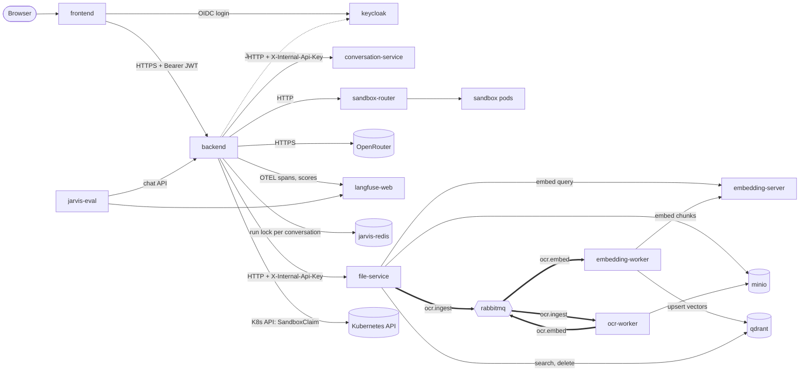

# How the Jarvis services talk to each other

Read this before changing anything another service depends on. It says **who calls whom, over what, with which
credentials, and where the contract is written down**. HTTP contracts are the machine-generated OpenAPI files in
[`openapi/`](openapi/); message contracts for RabbitMQ are described in the tables below until they get a
machine-readable spec of their own (see "Known gaps").

Everything here was read from the code and the manifests in `jarvis-deploy`, not from memory. If you change a call,
change this file in the same PR.

## The picture

Solid arrows are synchronous calls, thick arrows are RabbitMQ messages. Shared stores are listed under
"Who owns which data".

## Synchronous calls (HTTP)

| Caller | Callee | Address | Auth | What for | Contract |
|---|---|---|---|---|---|
| browser / frontend | backend | `http://api.jarvis.local` (ingress), prefix `/api/v1` | `Authorization: Bearer <Keycloak JWT>` | everything the UI does: chat stream, conversations, files, MCP servers, user models | [`openapi/backend.json`](openapi/backend.json) |
| frontend | keycloak | `http://auth.jarvis.local/realms/jarvis` | OIDC (NextAuth) | login | Keycloak's own |
| backend | keycloak | `http://keycloak.jarvis.svc.cluster.local:8080/realms/jarvis/protocol/openid-connect/certs` | none | fetch signing keys to verify the JWT; cached `OIDC_JWKS_CACHE_TTL_SECONDS` (3600) | OIDC |
| backend | conversation-service | `http://conversation-service.jarvis.svc.cluster.local:8000` | `X-Internal-Api-Key` | conversation list, titles, last model, context-token gauge, sandbox session id, subagent traces, message traces | [`openapi/conversation-service.json`](openapi/conversation-service.json) |
| backend | file-service | `http://file-service.jarvis.svc.cluster.local:8000` | `X-Internal-Api-Key` | the user's file tree, upload, rename, delete, content, vector / full-text search, rerank | [`openapi/file-service.json`](openapi/file-service.json) |
| file-service | embedding-server | `http://embedding-server/v1` (OpenAI-compatible `/v1/embeddings`, model `bge-m3`) | none | embed a search query | TEI / OpenAI embeddings API |
| backend | sandbox-router | `http://sandbox-router-svc.agent-sandbox-system.svc.cluster.local:8080` | none (`ALLOW_UNAUTHENTICATED_ROUTER=true`) | run a command / read / write a file in a conversation's sandbox; the pod IP travels in `X-Sandbox-Pod-IP` | agent-sandbox upstream |
| backend | Kubernetes API | in-cluster | ServiceAccount `jarvis-backend` | create / list / patch / delete `SandboxClaim`, read `Sandbox` | agent-sandbox CRDs |
| backend | OpenRouter | `https://openrouter.ai/api/v1` | API key | LLM calls (and the fallback chain) | OpenAI-compatible |
| backend | jarvis-redis | `redis://jarvis-redis.jarvis.svc.cluster.local:6379` | none | one lease key per conversation while a chat run is going (`SET NX PX 30000`, renewed every 10 s); a second chat / resume request on the same conversation gets `409`. If Redis is unreachable the backend falls back to an in-process lock | `app/core/conversation_lock.py` |
| backend | langfuse-web | `http://langfuse-web.jarvis.svc.cluster.local:3000` | Langfuse key pair | spans (OTEL) and feedback scores | Langfuse |
| backend | user MCP servers, the web | URLs the user or the model supplies | per server | MCP tools, `web_search`, `web_fetch` | MCP / HTTP |
| jarvis-eval | keycloak | `auth.jarvis.local`, OIDC password grant | username + password of an eval user | get a JWT per eval user (users are created through Keycloak's Admin API) | OIDC |
| jarvis-eval | backend | chat, conversations and files endpoints, as an eval user | Bearer JWT | run a benchmark question through the real agent; seed and clean the eval files | `openapi/backend.json` |
| jarvis-eval | langfuse-web | Langfuse SDK | key pair | datasets, experiment runs | Langfuse |

The two internal services (`conversation-service`, `file-service`) trust one shared secret, `INTERNAL_API_KEY`,
and take the user id as a parameter. They do not see the user's JWT. Only `backend` is reachable from outside.

## Asynchronous messages (RabbitMQ)

Broker `rabbitmq:5672`, default exchange, routing key = queue name. Each stage has a main queue, a `.retry` queue
and a `.dlq`. A failed message is republished to `.retry`, waits `RETRY_TTL_MS` (10 s) and is dead-lettered back
to the main queue; after `MAX_ATTEMPTS` (3) it is nack'ed into the `.dlq`.

| Queue | Producer | Consumer | Payload | Notes |
|---|---|---|---|---|
| `ocr.ingest` | file-service (outbox relay, `app/saga/outbox.py`) | ocr-worker | `{"file_id": "<uuid>"}` | written to the `outbox` table in the same transaction as the file row, published at-least-once, consumers are idempotent |
| `ocr.embed` | ocr-worker | embedding-worker | `{"file_id": "<uuid>", "chunks": [{"text", "page_start", "page_end", "boxes": [[page, [x0, top, x1, bottom], [local_start, local_end]]], "char_start", "char_end"}]}` | the message is the only copy of the chunks until they are embedded |

Queue names and arguments live in `app/queue/topology.py`, **copied into file-service, ocr-worker and
embedding-worker**. RabbitMQ refuses a declaration whose arguments differ from the existing queue's, so the three
copies must stay identical.

## Who owns which data

| Store | Owner (writes its schema) | Also touched by |
|---|---|---|
| Postgres `jarvis`, schema `jarvis` (LangGraph checkpoints, store, attachments, message feedback, user models, user MCP servers) | backend | |
| Postgres `jarvis_conversations` | conversation-service | |
| Postgres `jarvis_files` (`files` tree, `outbox`, indexing status) | file-service | **ocr-worker and embedding-worker write `indexing_status` / `error_stage` / attempt counts directly** |
| MinIO bucket `jarvis-files` | file-service | ocr-worker reads the original file |
| Qdrant collection `file_chunks` | embedding-worker writes the vectors | file-service searches it and deletes a file's points |
| Redis `jarvis-redis` (conversation run locks, nothing persisted) | backend | |
| Postgres `langfuse`, ClickHouse, Redis, MinIO bucket `langfuse` | Langfuse | |
| Postgres of Keycloak | keycloak | |

## Known gaps in the contracts

1. **The `ocr.embed` payload has no machine-readable spec.** The shape is defined by `_chunk_to_dict` in
   ocr-worker and read by embedding-worker; nothing checks that they agree.
2. **`topology.py` exists in three copies** that must match byte for byte.
3. **The workers share file-service's database.** A change to the `files` table affects three services, and none
   of them says so in an API.
4. **Internal auth is one shared key**, and the sandbox router accepts unauthenticated callers.
5. **No contract tests yet.** The OpenAPI check (below) catches a changed endpoint, not a caller that expects
   something the callee never promised.

## Changing a contract

1. Change the code, then run `python3 jarvis-deploy/contracts/export_openapi.py` and commit the updated JSON in
   `jarvis-deploy` alongside (or right after) the service change. Read the `BREAKING` lines it prints.
2. A breaking change to an endpoint another service calls needs the caller changed first or in the same release:
   add the new field or endpoint, move the callers, then remove the old one.
3. Changing a queue name, its arguments or the `ocr.embed` payload means editing every producer and consumer
   listed above, and the copies of `topology.py`, in one release (queued messages from the old version are still
   in the broker when the new one starts, so keep readers tolerant of the old shape for a while).
4. Update this file when a caller, an address, a credential or a queue changes.
